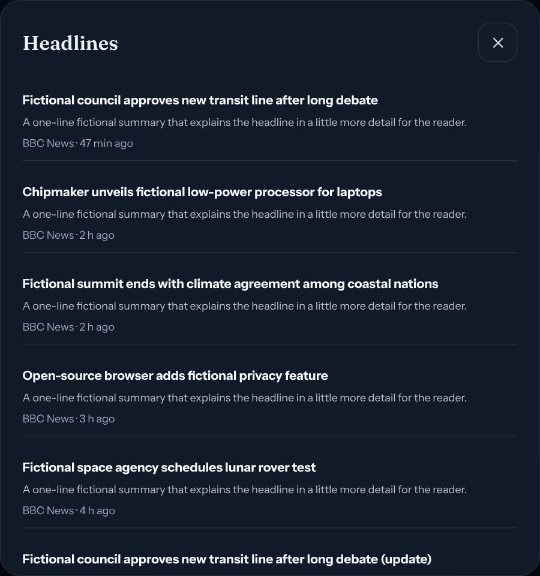
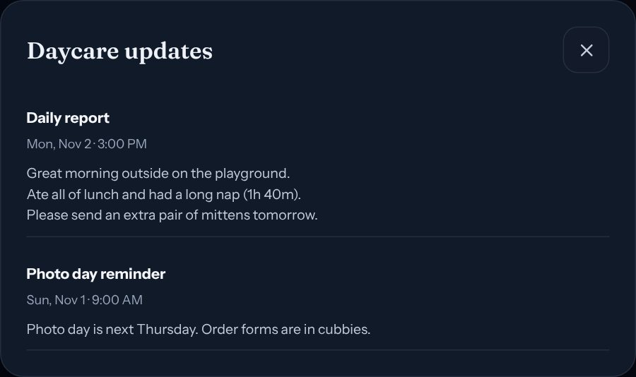

<div align="center">

# FamilyHub

**A self-hosted family dashboard on a Raspberry Pi, shown on an inexpensive photo frame.**

Google Calendar and Tasks, daycare updates, chores, weather, news and the next
Formula 1 weekend — managed from your phone over a private network, displayed
read-only in the kitchen.


<sub>All screenshots use fictional data.</sub>

</div>

FamilyHub is a fork of [OpenFamily](https://github.com/NexaFlowFrance/OpenFamily)
(AGPL-3.0). It keeps OpenFamily's accounts, database, budget and pocket money,
and adds a Google-backed household dashboard, a read-only ambient display for a
photo frame, and a Raspberry Pi deployment with versioned, self-updating
releases. Since v1.0 it is its own product: OpenFamily modules it doesn't use
(recipes, meal planning, family posts, the kiosk) are gone, every remaining
module can be switched off per household (enforced by the server), it speaks
English and French, it can sign in with Google, and the Pi sends ntfy alerts
for renewals and updates.

**Contents:** [What it does](#what-it-does) · [The photo frame hack](#the-photo-frame-hack) ·
[How it fits together](#how-it-fits-together) · [Running it](#running-it) ·
[Documentation](#documentation) · [Wishlist](#wishlist) · [Credits and licence](#credits-and-licence)

## What it does

| Feature | What it does |
| --- | --- |
| **Family calendar** | One shared Google Calendar is the source of truth. Month/week/day views, event colours and a household colour legend. |
| **To-dos** | A shared Google Tasks list, editable from FamilyHub or Google's own apps. |
| **Daycare updates** | Lillio/HiMama emails from the family Gmail account, summarised. |
| **Chores and pocket money** | OpenFamily chores (with optional points), approvals and balances. |
| **Modules you choose** | To-dos, Chores, Pocket money, Daycare, School, Notes, Budget, Shopping, Weekly routines, Integrations (Home Assistant, Nextcloud, Immich) and an AI assistant, each on or off for the household. |
| **Sign in with Google** | Optional, alongside or instead of passwords; new accounts still need an invitation. |
| **Alerts on your phone** | ntfy pushes for expiring credentials, installed releases and failed updates. |
| **Ambient display** | A read-only, glanceable dashboard for a wall or counter screen, with detail panels, night dimming and a news reader. |
| **Private by default** | Management works only over the household's Tailscale network. The photo frame reaches a separate, display-only listener on the home network. |
| **Self-updating** | Tagging a release builds ARM64 images in GitHub Actions; the Pi installs it within the hour with a backup first. |

### The display

Every card opens a detail panel in place — the frame never navigates away.

| Next 7 days | Headlines | Reader view |
| --- | --- | --- |
|  |  |  |

* **Up next** shows the next three events with day labels and "+2 more events today"; To-dos and News show "+N more".
* **Weather** (Open-Meteo) includes tomorrow's forecast; **Formula 1** (Jolpica) shows the next session in your time zone.
* **News** (opt-in) lists ten BBC World and Technology headlines. Tapping one opens a reader view built on the Pi with Mozilla Readability, so the frame downloads a few kilobytes of text instead of a news page.
* **Night mode** dims the screen on a schedule; a tap wakes it for two minutes.
* The display is read-only. A 2-second **Hold to exit** is the only way out.

### Management

| Display setup | Pairing a frame | Server credentials |
| --- | --- | --- |
|  |  | *Expiry date, days left and a **Replace** button for each credential (screenshot omitted).* |

The navigation shows as many tabs as fit and moves the rest into **More**.
Settings has **Your name** (used in the display greeting) and, for the household
owner, **Advanced → Server credentials**: expiry dates for everything the Pi
depends on, and a tested way to replace a token from the browser.

## The photo frame hack

The display runs on an inexpensive Frameo Wi-Fi photo frame. Frameo frames are cheap
Android tablets in a picture-frame body, which makes them good always-on
dashboards — with some quirks. Here is what we found on ours, so you can judge
whether yours is similar.

### What is inside

| | Our unit (label on the back: **105K**) |
| --- | --- |
| Board | Rockchip RK312x |
| Android | 6.0.1 (API 23). The firmware fingerprint says `userdebug`, but `adb root` is refused |
| Browser engine | Android System WebView 107 |
| Screen | 1280 × 800, landscape |
| Stock apps | Frameo (`net.frameo.frame`), a firmware updater (`com.adups.fota`) |
| ADB | Over USB from a Mac (`brew install --cask android-platform-tools`) |

Check *Settings → About* on yours before following these steps; frames sold
under the same name use different boards and firmware.

### How it is set up

1. **A kiosk launcher.** The frame runs [HomeHQ](https://github.com/wesbos/photo-frame-dashboard)
   (`com.wesbos.homehq`, from Wes Bos's photo-frame-dashboard) as its **Home**
   app, chosen with *Always*. It opens one URL full-screen at boot, retries with
   a friendly offline screen, and has a small Back/Dashboard bar.
2. **Save the URL the right way.** HomeHQ only *remembers* a URL passed as its
   `url` extra. A plain "open this link" intent loads it once and the next
   restart shows HomeHQ's sample "Placeholder · offline" page:

   ```sh
   adb shell am start -n com.wesbos.homehq/.MainActivity --es url https://frame.example.com/display
   ```
3. **Stock software out of the way.** Frameo and the firmware updater are
   disabled/hidden so they cannot cover the dashboard or update themselves.
   Without `adb root` the shell can unhide an app but not re-enable it; use the
   app's *App info* screen for that. Android's System UI is also disabled (no
   status or navigation bars), which removes the Settings brightness slider —
   set brightness with `adb shell settings put system screen_brightness 0-255`,
   or temporarily enable Frameo.
4. **A real hostname on the home network.** The frame cannot join Tailscale.
   Custom DNS on Android 6 did not stick: the router advertised IPv6 DNS
   servers, which Android preferred, and the override reset after reconnects.
   What works: a public DNS **A record** (Cloudflare, *DNS only*) for
   `frame.<your-domain>` pointing at the Pi's **private** LAN address, with a
   Let's Encrypt certificate issued by DNS-01. The name resolves anywhere but
   only answers inside the house, and the frame uses ordinary DHCP DNS.
5. **A display-only listener on the Pi.** Host Caddy binds to the Pi's LAN
   address and allows just the display pages, static assets and the seven
   API calls the display makes; every other page redirects to `/display` and every other API path
   returns 404. An nftables table accepts HTTPS only from the frame's reserved
   address (plus SSH from the home network). Management stays on Tailscale.
6. **Pairing, not passwords.** The frame shows a pairing screen. A parent
   creates an 8-digit, 5-minute code in Display setup; the frame gets a
   read-only token tied to its own revocable session.

| The frame's pairing screen | Tap a card for details |
| --- | --- |
|  |  |

### Performance notes for a slow frame

* Full-screen `backdrop-filter: blur()` made panels sluggish on the RK312x GPU;
  a solid scrim looks the same and is instant.
* WebView 107 has no `dvh` units; keep a `vh` fallback. `:has()` works.
* Let the server do heavy lifting (reader-view extraction, data trimming) and
  send the frame small JSON. The display polls once a minute and skips the
  WebSocket.
* Renew the display's session on every page load — frames reload and sleep
  more often than you expect.

Full details, commands and troubleshooting: [photo frame guide](knowledge-base/16-photo-frame.md).

## How it fits together

```
Phones / Mac ──Tailscale──▶ Tailscale Serve (HTTPS) ──┐
                                                       ├──▶ 127.0.0.1:8080
Photo frame ──home Wi-Fi──▶ Caddy LAN listener ───────┘     client (nginx)
  frame.<domain>/display     (display routes only)            └▶ server (Express)
                                                                   ├▶ PostgreSQL
Raspberry Pi 4, Debian 13, Docker                                  └▶ Google, Open-Meteo,
  nftables: HTTPS from the frame, SSH from home, drop the rest        Jolpica F1, BBC News
  familyhub-update.timer   hourly; installs new GitHub releases
  familyhub-renewals.timer daily; warns before anything expires
```

| Path | What lives there |
| --- | --- |
| `client/src/familyhub/` | FamilyHub UI: dashboard, display, pairing, settings |
| `server/src/routes/familyhub.ts`, `server/src/services/familyhub/` | FamilyHub API, Google adapters, ambient snapshot, news, credentials bridge |
| `server/src/migrations/familyhub/` | Namespaced, additive database migrations |
| `deploy/familyhub/` | Compose files, release updater, LAN display listener, Pi admin helpers, frame helper |
| `knowledge-base/` | The operating guide |
| `docs/familyhub/` | Detailed design notes and release records |

## Running it

* **Develop:** work on the `develop` branch. `npm ci`, then `npm run dev:familyhub`
  for the fictional prototype or `npm run dev:familyhub:develop` for the signed-in
  preview at `http://127.0.0.1:5174/develop/`; see
  [development and architecture](knowledge-base/12-development-architecture.md).
* **Release:** merge `develop` into `familyhub/prototype`, then run **Family Hub
  release** in Actions (or push a `familyhub-vX.Y.Z` tag). The workflow tests, builds
  ARM64/AMD64 images and publishes a private release; the Pi installs it within
  the hour. See [releases and updates](knowledge-base/09-releases-updates.md).
* **Deploy:** [Raspberry Pi deployment](knowledge-base/07-raspberry-pi.md),
  [photo frame](knowledge-base/16-photo-frame.md),
  [renewals and credentials](knowledge-base/17-renewals-and-credentials.md).

Nothing here is a hosted service: you need your own Google Cloud OAuth client,
Tailscale network, domain (for the frame) and Raspberry Pi.

## Documentation

Start with the [knowledge base](knowledge-base/README.md). It covers using
FamilyHub, accounts, Google, daycare, the Pi, networking, the photo frame,
releases, renewals, backup and recovery, troubleshooting and security.

## Wishlist

Ideas for future builds live in [WISHLIST.md](WISHLIST.md) — add to it freely.

## Credits and licence

* [OpenFamily](https://github.com/NexaFlowFrance/OpenFamily) by NexaFlow France —
  the foundation of this project. The original README is kept at
  [docs/upstream/OPENFAMILY_README.md](docs/upstream/OPENFAMILY_README.md)
  (French and Chinese versions remain in the upstream repository).
* [HomeHQ / photo-frame-dashboard](https://github.com/wesbos/photo-frame-dashboard) by Wes Bos — the frame's kiosk launcher.
* [Open-Meteo](https://open-meteo.com/) weather, [Jolpica F1](https://github.com/jolpica/jolpica-f1) schedules,
  [BBC News](https://www.bbc.co.uk/news) RSS (personal, non-commercial use) and
  [Mozilla Readability](https://github.com/mozilla/readability).
* Formula 1 and team logos shown on the display are supplied locally by the
  household and are the property of their owners.

GNU Affero General Public License v3.0 — see [licence.md](licence.md). If you run
a modified version for others, the AGPL requires offering them its source.
