<div align="center">

# FamilyHub

**A self-hosted family dashboard on a Raspberry Pi, shown on an inexpensive photo frame.**

Google Calendar and Tasks, daycare updates, chores, shared budgets, weather,
news and the next Formula 1 weekend: managed from your phone over a private
network, displayed read-only in the kitchen.

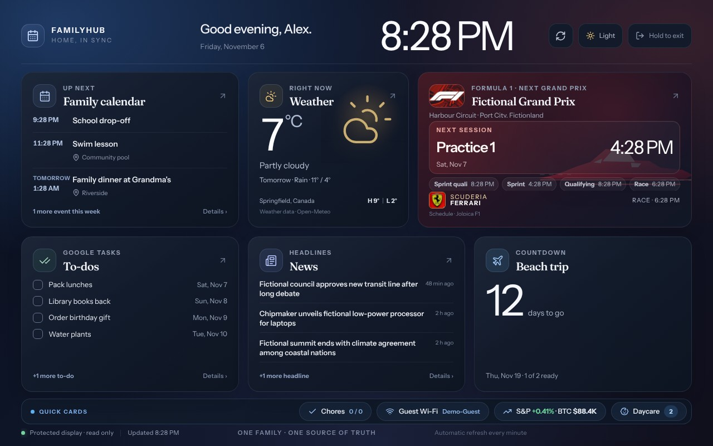

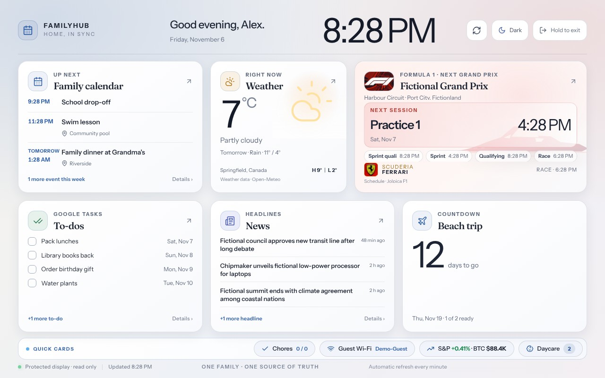

<sub>The display in its dark and light themes. All screenshots use fictional data.</sub>

</div>

FamilyHub is a fork of [OpenFamily](https://github.com/NexaFlowFrance/OpenFamily)
(AGPL-3.0). It keeps OpenFamily's accounts, database, budget and pocket money,
and adds a Google-backed household dashboard, a read-only ambient display for a
photo frame, and a Raspberry Pi deployment with versioned, self-updating
releases. Since v1.0 it is its own product: OpenFamily modules it doesn't use
(recipes, meal planning, family posts, the kiosk) are gone, every remaining
module can be switched off per household (enforced by the server), and it speaks
English and French. The current release is **v1.5.5**.

It is built for one household that wants to run its own server: your data stays
on your Pi, Google Calendar and Tasks stay the source of truth, and nothing is
hosted by anyone else. Phones and computers manage it over Tailscale; the frame
only ever sees a separate, display-only listener.

**Contents:** [What it does](#what-it-does) · [Install it](#install-it) · [The photo frame hack](#the-photo-frame-hack) ·
[How it fits together](#how-it-fits-together) · [Running it](#running-it) ·
[Documentation](#documentation) · [Wishlist](#wishlist) · [Credits and licence](#credits-and-licence)

## What it does

| Feature | What it does |
| --- | --- |
| **Family calendar** | One shared Google Calendar is the source of truth. Month/week/day views, event colours with a household colour legend, and creating, editing and deleting events from FamilyHub. |
| **To-dos** | A shared Google Tasks list, editable from FamilyHub or Google's own apps. |
| **Daycare updates** | Lillio/HiMama emails from the family Gmail account, summarised. |
| **Chores and pocket money** | OpenFamily chores (with optional points), approvals and balances. |
| **Shared budgets** | Record who paid and how an expense is split, keep expense groups, settle up, and import a Splitwise CSV export. Fixed, icon-tiled categories; monthly totals and limits. |
| **Modules you choose** | To-dos, Chores, Pocket money, Daycare, School, Notes, Budget, Shopping, Weekly routines, Integrations (Home Assistant, Nextcloud, Immich) and an AI assistant, each on or off for the household. Members can hide modules from their own menu. |
| **Two looks** | Classic, or the calmer **Board Book** look for the management app, switchable per person, with a light and dark theme. |
| **Ambient display** | A read-only, glanceable dashboard for a wall or counter screen: detail panels, a quick-cards bar, a light/dark toggle, night dimming (or off) and a screensaver. |
| **Alerts on your phone** | ntfy pushes for expiring credentials, installed releases and failed updates. |
| **Private by default** | Management works only over the household's Tailscale network. The photo frame reaches a separate, display-only listener on the home network. |
| **Self-updating** | Tagging a release builds ARM64 images in GitHub Actions; the Pi installs it within the hour with a backup first. Administrators can also check and install updates, or restart, from Settings. |

### The display

Every card opens a detail panel in place: the frame never navigates away.

| Next 7 days | Headlines | Reader view |
| --- | --- | --- |
| 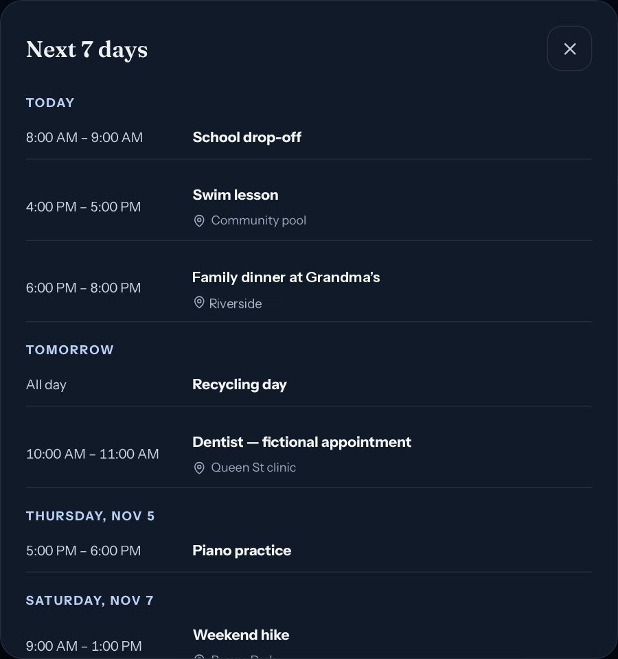 |  | 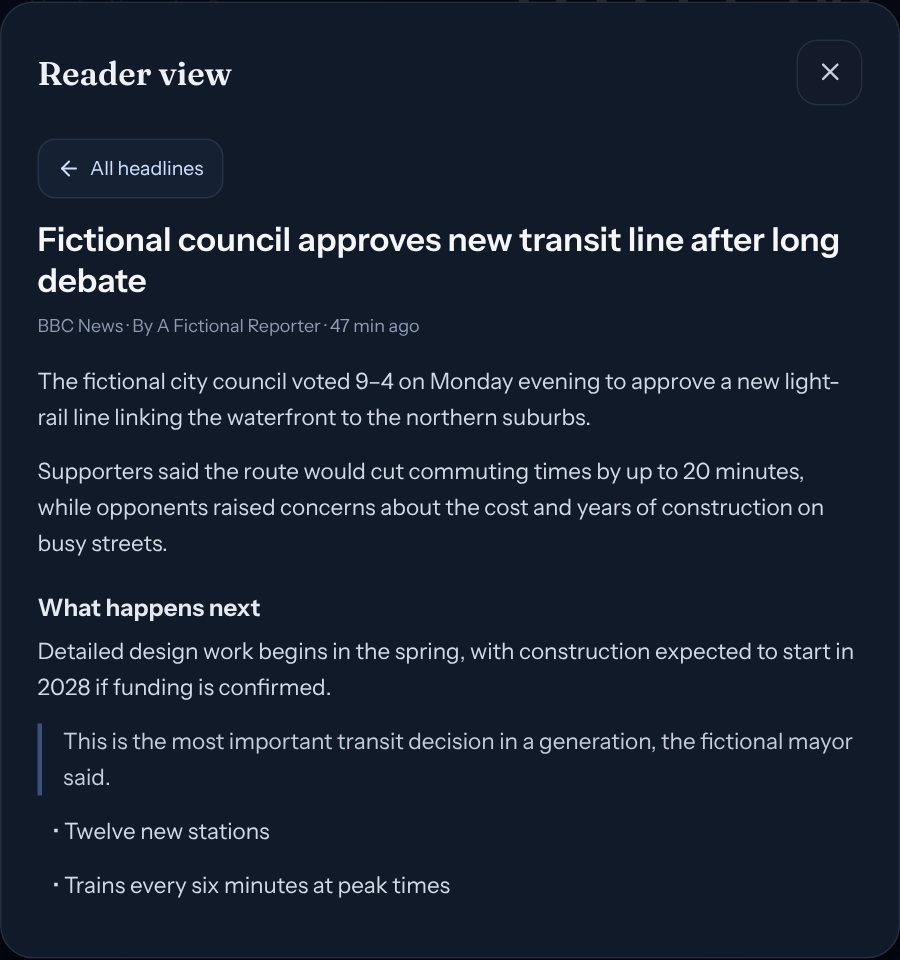 |

The same display works on a phone, so you can check it from the couch:

| Home | Weather & sky | Formula 1 |
| --- | --- | --- |
| 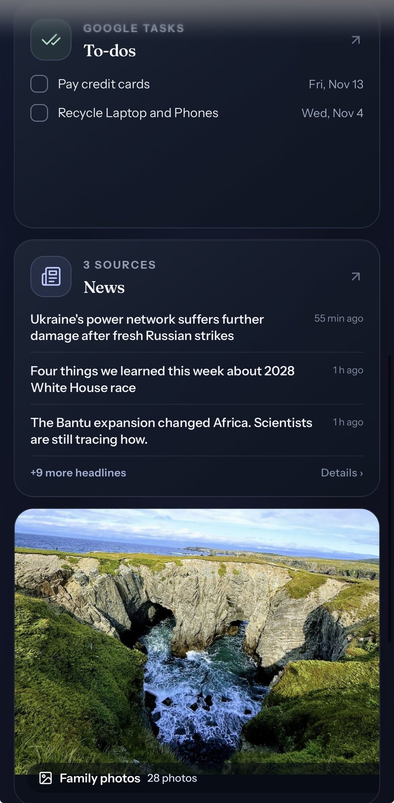 | 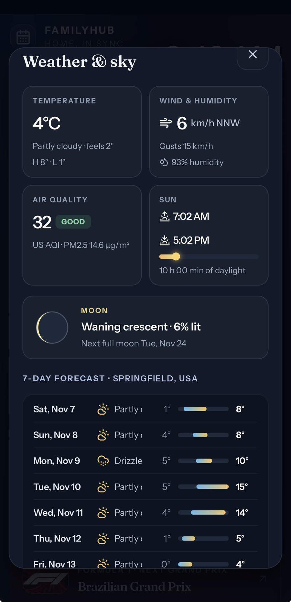 | 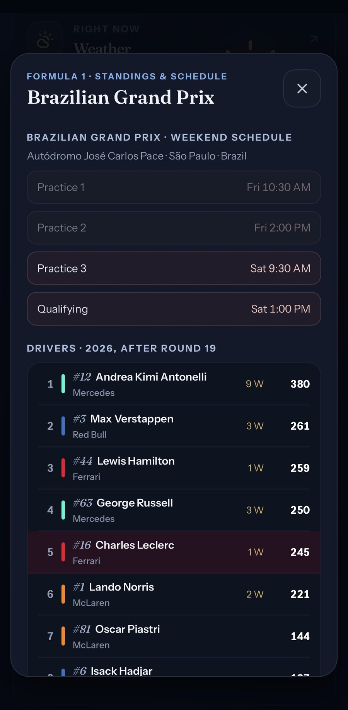 |

| Stocks and crypto | Photo slideshow |
| --- | --- |
| 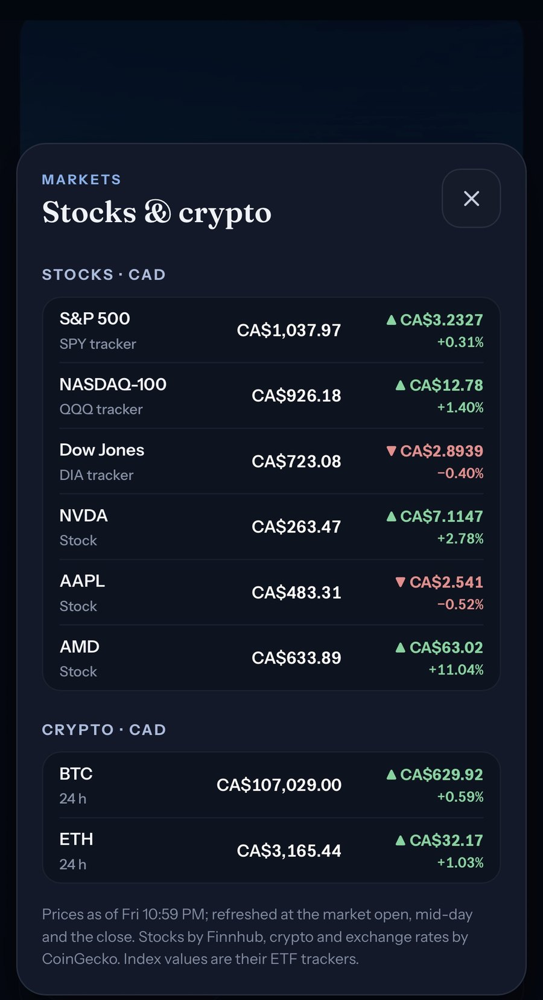 | 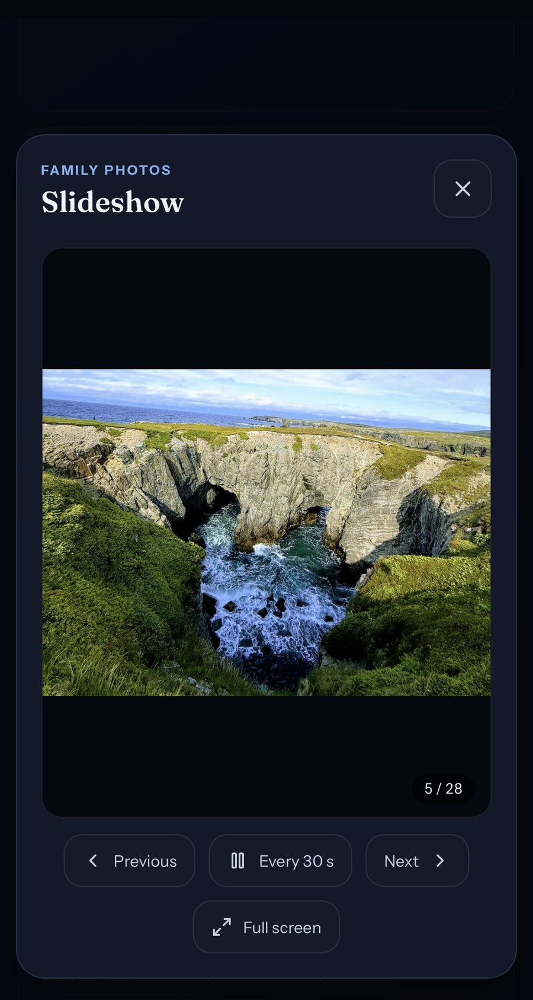 |

* **Choose your cards.** Settings → Display → Layout puts up to six cards on the main grid and the rest in a **quick-cards** bar, in the order you pick.
* **Up next** shows the next events with their Google Calendar colour and day labels; To-dos and News show "+N more".
* **Weather** (Open-Meteo) adds a detail panel with a seven-day forecast, sunrise and sunset, air quality and the moon phase. **Formula 1** (Jolpica) shows the next session in your time zone, with driver and constructor standings and a favourite team.
* **Quick cards:** a guest Wi-Fi QR code, a countdown with a checklist, stocks and crypto, and a family photo slideshow from photos you upload.
* **News** (opt-in) lists headlines from RSS or Atom feeds you choose (BBC World and Technology by default). Tapping one opens a reader view built on the Pi with Mozilla Readability, so the frame downloads a few kilobytes of text instead of a news page.
* **Night mode** dims the screen on a schedule, or turns it fully black; a tap wakes it. The **screensaver** shows the family photos full screen after a chosen idle time.
* The display is read-only. A 2-second **Hold to exit** is the only way out.

### Management

| Display setup | Pairing a frame |
| --- | --- |
| 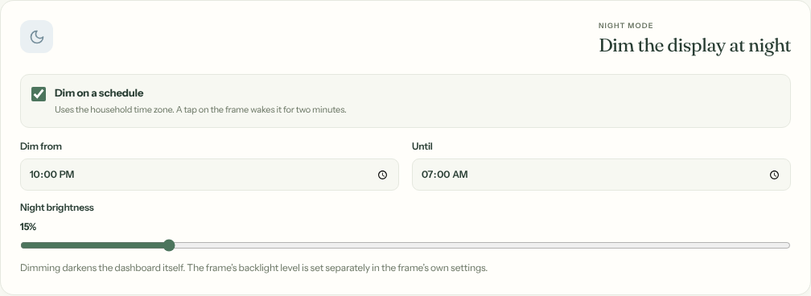 | 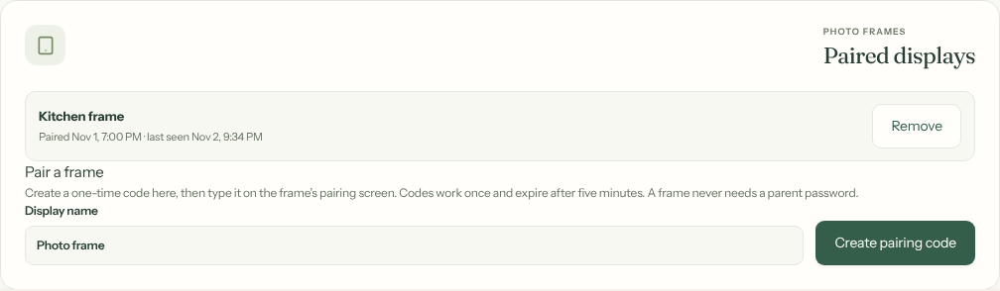 |

The navigation shows as many tabs as fit and moves the rest into **More**.
Settings has **Your name** (used in the display greeting), collapsible sections
and, for the server administrator, **Advanced**: expiry dates for everything the
Pi depends on with a tested way to replace a token from the browser, **Software
updates**, and a restart button.

## Install it

You need a Raspberry Pi 4 (or any Linux host with Docker), a Google account for
the household, and a [Tailscale](https://tailscale.com/) network so your phones
can reach it privately. The photo frame is optional.

**1. Get the code**

```sh
git clone https://github.com/santoshgs/familyhub-pub.git
cd familyhub-pub
git checkout main
```

Use `main` for the latest stable code and `develop` for work in progress. The
project is AGPL-3.0: keep the licence and notices if you publish changes.

**2. Try it on your computer (no accounts needed)**

You need Node.js 22.12 or newer.

```sh
npm ci
npm run dev:familyhub      # fictional prototype at the URL Vite prints
```

This opens a browser-only demo with made-up data. For the signed-in app against
a local database, see
[local development](docs/familyhub/LOCAL_DEVELOPMENT.md).

**3. Set up Google**

Create a Google Cloud OAuth client for the household's Google account and enable
the Calendar, Tasks and Gmail APIs. Step by step:
[Google setup](docs/familyhub/GOOGLE_SETUP.md). Keep the client secret on the
server only.

**4. Run it on a server**

Copy `deploy/familyhub/env.example` to `.familyhub-local/deployment.env` (owner
read/write only) and fill in the hostname, a strong database password, a
`JWT_SECRET` (`openssl rand -hex 32`), the Google client values and your time
zone (`TZ`). Then, from the repository root:

```sh
docker compose --env-file .familyhub-local/deployment.env -f deploy/familyhub/compose.yml build
docker compose --env-file .familyhub-local/deployment.env -f deploy/familyhub/compose.yml up -d
node scripts/familyhub-smoke.mjs https://<your-hostname>
```

Set `REGISTRATION_ENABLED=true` just long enough to create the first account (it
becomes the server administrator unless you set `FAMILYHUB_ADMIN_EMAIL`), then
turn it off again. HTTPS and DNS must work before you use real data; the
[Raspberry Pi guide](knowledge-base/07-raspberry-pi.md) and
[Tailscale guide](knowledge-base/08-tailscale-networking.md) cover this setup.

**5. Add the photo frame and self-updates (optional)**

Pair a frame with the one-time code flow in the
[photo frame guide](knowledge-base/16-photo-frame.md), and turn on hourly
self-updates from your own tagged releases with
[releases and updates](knowledge-base/09-releases-updates.md).

## The photo frame hack

The display runs on an inexpensive Frameo Wi-Fi photo frame. Frameo frames are cheap
Android tablets in a picture-frame body, which makes them good always-on
dashboards — with some quirks. Here is what we found on ours, so you can judge
whether yours is similar.

### What is inside

| | Our unit (label on the back: **105K**) |
| --- | --- |
| Board | Rockchip RK312x |
| Android | 6.0.1 (API 23). The firmware fingerprint says `userdebug`, but `adb root` is refused |
| Browser engine | Android System WebView 107 |
| Screen | 1280 × 800, landscape |
| Stock apps | Frameo (`net.frameo.frame`), a firmware updater (`com.adups.fota`) |
| ADB | Over USB from a Mac (`brew install --cask android-platform-tools`) |

Check *Settings → About* on yours before following these steps; frames sold
under the same name use different boards and firmware.

### How it is set up

1. **A kiosk launcher.** The frame runs [HomeHQ](https://github.com/wesbos/photo-frame-dashboard)
   (`com.wesbos.homehq`, from Wes Bos's photo-frame-dashboard) as its **Home**
   app, chosen with *Always*. It opens one URL full-screen at boot, retries with
   a friendly offline screen, and has a small Back/Dashboard bar.
2. **Save the URL the right way.** HomeHQ only *remembers* a URL passed as its
   `url` extra. A plain "open this link" intent loads it once and the next
   restart shows HomeHQ's sample "Placeholder · offline" page:

   ```sh
   adb shell am start -n com.wesbos.homehq/.MainActivity --es url https://frame.example.com/display
   ```
3. **Stock software out of the way.** Frameo and the firmware updater are
   disabled/hidden so they cannot cover the dashboard or update themselves.
   Without `adb root` the shell can unhide an app but not re-enable it; use the
   app's *App info* screen for that. Android's System UI is also disabled (no
   status or navigation bars), which removes the Settings brightness slider —
   set brightness with `adb shell settings put system screen_brightness 0-255`,
   or temporarily enable Frameo.
4. **A real hostname on the home network.** The frame cannot join Tailscale.
   Custom DNS on Android 6 did not stick: the router advertised IPv6 DNS
   servers, which Android preferred, and the override reset after reconnects.
   What works: a public DNS **A record** (Cloudflare, *DNS only*) for
   `frame.<your-domain>` pointing at the Pi's **private** LAN address, with a
   Let's Encrypt certificate issued by DNS-01. The name resolves anywhere but
   only answers inside the house, and the frame uses ordinary DHCP DNS.
5. **A display-only listener on the Pi.** Host Caddy binds to the Pi's LAN
   address and allows just the display pages, static assets and the seven
   API calls the display makes; every other page redirects to `/display` and every other API path
   returns 404. An nftables table accepts HTTPS only from the frame's reserved
   address (plus SSH from the home network). Management stays on Tailscale.
6. **Pairing, not passwords.** The frame shows a pairing screen. A parent
   creates an 8-digit, 5-minute code in Settings → Display; the frame gets a
   read-only token tied to its own revocable session.

| The frame's pairing screen | Tap a card for details |
| --- | --- |
| 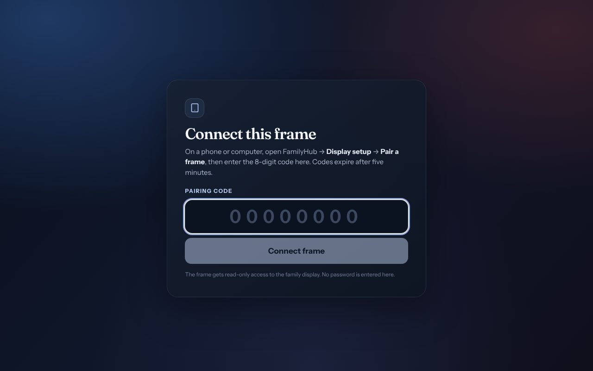 |  |

### Performance notes for a slow frame

* Full-screen `backdrop-filter: blur()` made panels sluggish on the RK312x GPU;
  a solid scrim looks the same and is instant.
* WebView 107 has no `dvh` units; keep a `vh` fallback. `:has()` works.
* Let the server do heavy lifting (reader-view extraction, data trimming) and
  send the frame small JSON. The display polls once a minute and skips the
  WebSocket.
* Renew the display's session on every page load — frames reload and sleep
  more often than you expect.

Full details, commands and troubleshooting: [photo frame guide](knowledge-base/16-photo-frame.md).

## How it fits together

```
Phones / Mac ──Tailscale──▶ Tailscale Serve (HTTPS) ──┐
                                                       ├──▶ 127.0.0.1:8080
Photo frame ──home Wi-Fi──▶ Caddy LAN listener ───────┘     client (nginx)
  frame.<domain>/display     (display routes only)            └▶ server (Express)
                                                                   ├▶ PostgreSQL
Raspberry Pi 4, Debian 13, Docker                                  └▶ Google, Open-Meteo,
  nftables: HTTPS from the frame, SSH from home, drop the rest        Jolpica F1, BBC News
  familyhub-update.timer   hourly; installs new GitHub releases
  familyhub-renewals.timer daily; warns before anything expires
```

| Path | What lives there |
| --- | --- |
| `client/src/familyhub/` | FamilyHub UI: dashboard, display, pairing, settings |
| `server/src/routes/familyhub.ts`, `server/src/services/familyhub/` | FamilyHub API, Google adapters, ambient snapshot, news, credentials bridge |
| `server/src/migrations/familyhub/` | Namespaced, additive database migrations |
| `deploy/familyhub/` | Compose files, release updater, LAN display listener, Pi admin helpers, frame helper |
| `knowledge-base/` | The operating guide |
| `docs/familyhub/` | Detailed design notes and release records |

## Running it

* **Develop:** work on the `develop` branch. `npm ci`, then `npm run dev:familyhub`
  for the fictional prototype or `npm run dev:familyhub:develop` for the signed-in
  preview at `http://127.0.0.1:5174/develop/`; see
  [development and architecture](knowledge-base/12-development-architecture.md).
* **Release:** merge `develop` into `familyhub/prototype`, then run **Family Hub
  release** in Actions (or push a `familyhub-vX.Y.Z` tag). The workflow tests, builds
  ARM64/AMD64 images and publishes a private release; the Pi installs it within
  the hour. See [releases and updates](knowledge-base/09-releases-updates.md).
* **Deploy:** [Raspberry Pi deployment](knowledge-base/07-raspberry-pi.md),
  [photo frame](knowledge-base/16-photo-frame.md),
  [renewals and credentials](knowledge-base/17-renewals-and-credentials.md).

Nothing here is a hosted service: you need your own Google Cloud OAuth client,
Tailscale network, domain (for the frame) and Raspberry Pi.

## Documentation

Start with the [knowledge base](knowledge-base/README.md). It covers using
FamilyHub, accounts, Google, daycare, the Pi, networking, the photo frame,
releases, renewals, backup and recovery, troubleshooting and security.

## Wishlist

Ideas for future builds live in [WISHLIST.md](WISHLIST.md) — add to it freely.

## Credits and licence

* [OpenFamily](https://github.com/NexaFlowFrance/OpenFamily) by NexaFlow France —
  the foundation of this project. The original README is kept at
  [docs/upstream/OPENFAMILY_README.md](docs/upstream/OPENFAMILY_README.md)
  (French and Chinese versions remain in the upstream repository).
* [HomeHQ / photo-frame-dashboard](https://github.com/wesbos/photo-frame-dashboard) by Wes Bos — the frame's kiosk launcher.
* [Open-Meteo](https://open-meteo.com/) weather, [Jolpica F1](https://github.com/jolpica/jolpica-f1) schedules,
  [BBC News](https://www.bbc.co.uk/news) RSS (personal, non-commercial use) and
  [Mozilla Readability](https://github.com/mozilla/readability).
* Formula 1 and team logos shown on the display are supplied locally by the
  household and are the property of their owners.

GNU Affero General Public License v3.0 — see [licence.md](licence.md). If you run
a modified version for others, the AGPL requires offering them its source.
