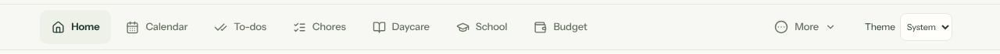
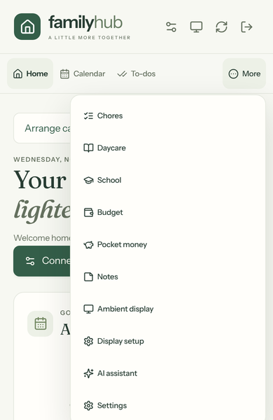
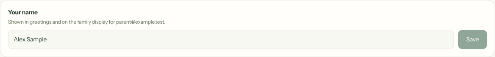
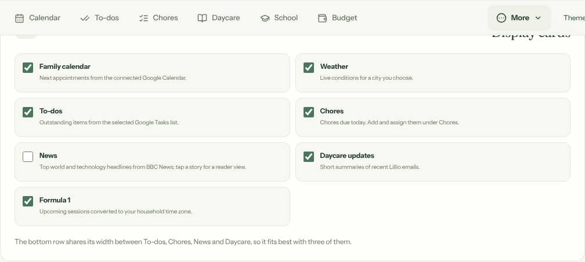
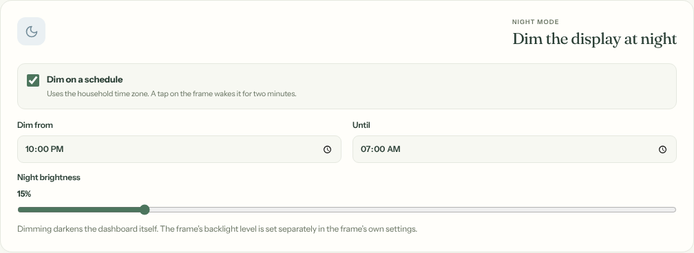

# Using Family Hub

[Knowledge base index](README.md) · [Accounts and access](03-accounts-and-access.md) · [Google integration](04-google-calendar-tasks.md)

Connect your device to the household Tailscale network, open the private Family Hub HTTPS address, and sign in with your Family Hub account. Your Google account is a separate integration. If the page cannot be found, start with [Tailscale and DNS](08-tailscale-networking.md).

## Navigation

The top bar shows as many destinations as fit the screen — Home, Calendar, To-dos, Chores, Daycare, School, then enabled modules — and moves the rest, in order, into **More**.

| Desktop | Phone |
| --- | --- |
|  |  |

## Overview and layout

The overview summarizes calendar events, tasks, family notes, daycare and other enabled cards. Open a card or its action for details. Notes can be added directly from the overview; the Notes page offers a fuller view.

Use **Arrange cards** to move cards with the up/down controls. Those controls also work with touch and keyboard; desktop users can drag card headings. Card order is stored per signed-in member, so another family member can have a different order. The reading and focus order follows the visual order.

Choose **Light**, **Dark**, or **System** from the theme control. The preference is saved in that browser; System follows the device's appearance setting.

## Calendar and its color legend

The overview shows a short upcoming summary. Open Calendar for month, week and day views, previous/next navigation, Today and refresh. This view reads the **one selected shared Google calendar**, not every calendar in the account. It preserves Google event colors where available, with fallback colors if Google's color metadata is unavailable. Creating an event writes to that calendar; event editing and deletion are not currently offered in this calendar UI.

Parents can edit the color legend beneath the overview calendar card to explain household conventions, such as a color representing a person. Labels are stored for the household and do not modify Google events or automatically infer a person's identity.

## To-Dos and notes

To-Do operations use the selected Google Tasks list. Create, edit, complete, reopen or delete tasks in Family Hub, then refresh or check the same list in the dedicated account's native Google Tasks app. Google Tasks scheduling in this integration is date-based; do not assume precise reminder-time parity.

Notes are stored in Family Hub's database. Parents can create and update notes, and notes can be pinned where the interface offers that control. Unlike Calendar and Tasks, notes are not synchronized to Google.

## Budget, pocket money and optional modules

**Chores** (in the navigation) are OpenFamily's household tasks: add a chore, assign family members, set a due date and, optionally, points. Chores due today appear on the family display. Budget and Pocket money reuse the original OpenFamily pages. Budget includes its classic, analytics/limits and Kakeibo views. Pocket money supports points, approvals, balances and goals; completing a Google To-Do does not automatically award points.

Parents can use **Settings → Modules** to switch modules on or off for the household: To-dos, Chores, Pocket money, Daycare, School, Notes, Budget, AI assistant, and (off for new households) Shopping, Weekly routines and Integrations. A module that is switched off is hidden and also closed on the server (its API answers 403 `MODULE_DISABLED`). Its records are kept and return when it is switched back on. Each person can also untick **Show** to leave a module out of their own menu and overview without affecting anyone else. Card order is per member. Family Hub is available in English and French. Existing portable upstream JSON exports do not include all Family Hub-specific preferences; database backups do. See [MODULES](../docs/familyhub/MODULES.md).

Daycare and AI have their own guides: [daycare](05-daycare-gmail.md) and [AI](06-ai-assistant.md). A read-only display has restricted controls; see [accounts and access](03-accounts-and-access.md).

## Your name

**Settings → Your name** changes the name shown in greetings, including "Good evening, …" on the family display. It applies to the account you are signed in as.

## The family display

**More → Display setup** chooses the display's cards (Calendar, Weather, To-dos, Chores, News, Daycare, Formula 1), the weather city, night dimming and paired frames. **More → Ambient display** previews it in your browser.

| Choose cards | Night mode |
| --- | --- |
|  |  |

The bottom row shares its width between To-dos, Chores, News and Daycare, so three of them fit best. See [the photo frame](16-photo-frame.md) for the device itself.

### Settings → Display (v1.2)

Parents set up the display's extras in **Settings → Display**, one collapsible section each:

* **Weather and Formula 1:** the weather panel adds feels-like, wind, humidity, air quality, sunrise and sunset, the moon phase and a 7- or 14-day forecast; Formula 1 adds driver and constructor standings with a favourite highlight beside the weekend schedule.
* **Guest Wi-Fi:** a QR code and the network name and password, generated on the Pi.
* **Countdown:** a title, a date and time, and a checklist.
* **Markets:** stocks (needs a Finnhub API key that you add; it is write-only afterwards) and crypto (CoinGecko).
* **Photos:** upload pictures from your phone for a slideshow (up to 200 per household, 25 MB each); the Pi scales them to 1280 × 800 and removes location and camera details.

The **quick bar** above the footer shows one pill each for Wi-Fi, the countdown, markets and photos, and a pill appears only once that feature is set up. Tapping a pill or a card opens its detail panel. The display stays read-only, so the countdown checklist cannot be ticked on the frame. Details and endpoints are in [AMBIENT_DISPLAY](../docs/familyhub/AMBIENT_DISPLAY.md).

## Software updates

**Settings → Advanced → Software updates** (server administrator only) shows the release running on the Pi and the newest stable release, and can ask the Pi to **check now** or **install now** without waiting for the hourly check. The Pi still picks the version, takes the backup, checks health and rolls back on failure by itself; the app cannot choose a version. See [releases and updates](09-releases-updates.md).
