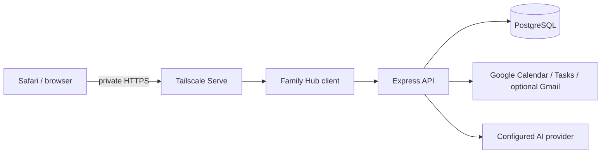

# Development and architecture

[Knowledge base index](README.md) · [Project overview](01-overview.md) · [History and verification](14-history-and-verification.md)

## Foundation and data flow

Family Hub extends OpenFamily's React/TypeScript/Vite frontend, Express/TypeScript backend, PostgreSQL database, authenticated WebSockets and Docker Compose deployment. The opt-in Family Hub UI lives under `client/src/familyhub/`; ordinary OpenFamily behavior remains available outside that mode. Do not replace existing OpenFamily features when they can be reused.



The Google adapter is server-side; the browser does not receive Google client secrets. Authenticated routes mediate access, distinguish parent and read-only display scopes, and use household ownership. The cache uses revisions and ordering to avoid reintroducing obsolete data after writes, source changes or disconnects. Calendar and Tasks remain authoritative at Google.

Private API responses are `no-store`; the service worker no longer provides offline household-data API caching. Existing tabs must receive an updated worker for policy changes to take effect. Test actual deployed behavior rather than assuming a build proves browser privacy.

## Code map

| Path | Purpose |
| --- | --- |
| [`client/src/familyhub/`](../client/src/familyhub/) | Family Hub views, appearance, calendar and fixture interfaces |
| [`server/src/routes/familyhub.ts`](../server/src/routes/familyhub.ts) | Authenticated Family Hub endpoints |
| [`server/src/services/familyhub/google/`](../server/src/services/familyhub/google/) | OAuth, Calendar/Tasks adapters, cache runtime and daycare parsing |
| `server/src/migrations/familyhub/` | Namespaced downstream migrations |
| [`deploy/familyhub/`](../deploy/familyhub/) | Compose templates, updater, timer and release policy |
| [`.github/workflows/familyhub-release.yml`](../.github/workflows/familyhub-release.yml) | Release validation and packaging |
| [`docs/familyhub/`](../docs/familyhub/) | Detailed incremental design, setup and the historical QA record |
| [`client/src/familyhub/version.ts`](../client/src/familyhub/version.ts) | Version label shown in footers (injected by `client/vite.config.ts`) |
| [`client/.snyk`](../client/.snyk) | Accepted Snyk dependency findings, with reasons and expiry |
| [`server/src/services/familyhub/extras/`](../server/src/services/familyhub/extras/) | v1.2 display extras on the Pi: weather panel, astronomy (moon phase), Formula 1, markets, guest Wi-Fi and countdown, photos (`sharp`), validated settings |
| [`server/src/services/familyhub/adminUpdates.ts`](../server/src/services/familyhub/adminUpdates.ts) | Software updates status and requests, written to the admin exchange |
| [`server/src/lib/asyncRoutes.ts`](../server/src/lib/asyncRoutes.ts) | Forwards every async route's errors to the error handler (v1.1) |
| [`server/src/utils/urlGuard.ts`](../server/src/utils/urlGuard.ts), [`server/src/lib/safeFetch.ts`](../server/src/lib/safeFetch.ts) | Outbound-request guard: blocks private and special addresses, pins the vetted IP (v1.1) |
| [`client/src/familyhub/AmbientExtras.tsx`](../client/src/familyhub/AmbientExtras.tsx), `DashboardExtrasSettings.tsx`, `ServerUpdates.tsx` | Quick bar and detail panels on the frame, Settings → Display, Settings → Software updates |
| [`client/src/familyhub/look.tsx`](../client/src/familyhub/look.tsx), `FamilyHubNav.tsx` (`AppShell`), `board.css`, `SettingsGroups.tsx`, `Classic*.tsx` | The Classic / Board Book trial switch and the Board Book management look; see [the looks](18-management-look.md) |

Family Hub is **web-only**. On November 4, 2026 the parts of OpenFamily it does not use were removed to shrink the code: the Android (Capacitor) app and its native-only code, the public website and waitlist endpoint, the Windows installer, CasaOS/Runtipi/Unraid packaging, Proxmox/update scripts, upstream-only workflows, and translated READMEs/install guides. They remain in Git history (tag `familyhub-v0.3.6`) and upstream. Merging a future upstream release will show conflicts in those paths; keep them deleted.

v1.0.0 (November 4, 2026) went further and removed OpenFamily's Recipes, Meal planning, Family posts, kiosk, Mealie/Tandoor/Grocy integrations, the Support OpenFamily card and every language except English and French. The remaining modules are one list in `server/src/lib/modules.ts`, mirrored in `client/src/familyhub/modules.ts`, and the server closes a module that is off. Expect conflicts there too when merging upstream.

## Migrations since v1.0

| Migration | Release | What it does |
| --- | --- | --- |
| `familyhub/0009` | v1.0.0 | Drops the removed modules' tables and Mealie/Tandoor/Grocy integration rows, moves other languages to English (destructive; rollback tested) |
| `familyhub/0010-module-visibility` | v1.0.0 | Per-member `hidden_modules` (the **Show** checkbox) |
| `familyhub/0011` | v1.1.0 | Nullable `push_subscriptions.account_id` and an index, so removal can delete a member's subscriptions |
| `familyhub/0012` | v1.2.0 | New tables `familyhub_dashboard_extras` (one validated JSON document per family, secrets encrypted apart) and `familyhub_photos` |

`deploy/familyhub/release-policy.json` records, per release, why each was safe to roll back. New dependencies in v1.2: `qrcode` (MIT) and `sharp` (Apache-2.0).

## Display constraints

The frame's WebView is old, so the client builds for Safari 15.4 and Chromium 104 (`client/vite.config.ts`). The display CSS added in v1.2 avoids `:has`, `color-mix`, nesting, `@layer` and `backdrop-filter` (the management pages do use some of them; only the display runs on the frame). One older rule, the Formula 1 logo mark in `ambient.css`, still uses `:has`, which the frame's WebView 107 supports but Chromium 104 does not. Everything heavy happens on the Pi: fetching, calculation, QR generation and image scaling. The display only counts down seconds from a server-sent target, and new display endpoints must be added to both the server's ambient allowlist and the LAN listener's `Caddyfile.lan`, after which the owner re-runs `apply-lan-display.sh`.

Preserve upstream history, license notices and root `ROADMAP.md`. Add Family Hub migrations in their namespace; do not edit shipped upstream migrations. The audited upstream base is recorded in [`UPSTREAM.md`](../UPSTREAM.md); its older statements about repository creation and Phase 1 are historical.

## Local modes

From a development checkout:

```sh
npm ci
npm run dev:familyhub          # fictional mock prototype; changes reset on reload
npm run dev:familyhub:local    # authenticated local stack on the prepared Mac
npm run dev:familyhub:develop  # same stack served at http://127.0.0.1:5174/develop/
```

Day-to-day work happens on the `develop` branch; `familyhub/prototype` is the release branch (see [releases](09-releases-updates.md)). The footer version comes from `VITE_FAMILYHUB_VERSION` in release images, otherwise from `git describe` against `familyhub-v*` tags, otherwise `dev`.

The mock mode is separate from live household data. The prepared Mac local stack uses frontend `127.0.0.1:5174`, backend `127.0.0.1:53001` and PostgreSQL `127.0.0.1:55432`; it depends on ignored local configuration and an existing cluster. The deployed Pi is a different system. Do not run the Mac's real-account Google synchronizer alongside the active Pi.

Keep fixtures fictional. Use the isolated `_test` database for tests and never point destructive test cleanup at the household database. Do not commit `.familyhub-local/`, `.env`, tokens, dumps, uploads or production records.

## Validation

```sh
node scripts/check-public-safe.mjs
npm run build
npm run build:familyhub
npm run build:familyhub:local
npm test --workspace=@openfamily/server   # needs a disposable *_test PostgreSQL database
npm run test:familyhub
FAMILYHUB_TEST_BUILT_SW=true node --test scripts/service-worker.test.mjs
python3 -m unittest discover -s deploy/familyhub -p 'test_release.py'
```

These are the release workflow's validation steps. At v1.2.0: 218 server tests (PostgreSQL 16); the client tests, the public-safety scan, the release-tool tests and the Pi admin-helper tests also passed. Add a regression test with every security fix (`server/test/securityV11.test.ts` holds the v1.1 ones).

Run backend/integration tests against the designated isolated test database using the repository's scripts. The release workflow also checks the built service worker and packaged containers. Builds, mocked provider tests, visual inspection, actual Safari use and live-provider round trips are distinct evidence. See [verification](14-history-and-verification.md) and the historical [QA record](../docs/familyhub/QA.md) (its screenshots are archived in Git history).
