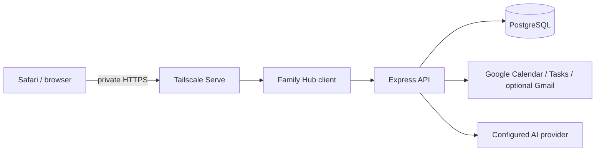

# Development and architecture

[Knowledge base index](README.md) · [Project overview](01-overview.md) · [History and verification](14-history-and-verification.md)

## Foundation and data flow

Family Hub extends OpenFamily's React/TypeScript/Vite frontend, Express/TypeScript backend, PostgreSQL database, authenticated WebSockets and Docker Compose deployment. The opt-in Family Hub UI lives under `client/src/familyhub/`; ordinary OpenFamily behavior remains available outside that mode. Do not replace existing OpenFamily features when they can be reused.



The Google adapter is server-side; the browser does not receive Google client secrets. Authenticated routes mediate access, distinguish parent and read-only display scopes, and use household ownership. The cache uses revisions and ordering to avoid reintroducing obsolete data after writes, source changes or disconnects. Calendar and Tasks remain authoritative at Google.

Private API responses are `no-store`; the service worker no longer provides offline household-data API caching. Existing tabs must receive an updated worker for policy changes to take effect. Test actual deployed behavior rather than assuming a build proves browser privacy.

## Code map

| Path | Purpose |
| --- | --- |
| [`client/src/familyhub/`](../client/src/familyhub/) | Family Hub views, appearance, calendar and fixture interfaces |
| [`server/src/routes/familyhub.ts`](../server/src/routes/familyhub.ts) | Authenticated Family Hub endpoints |
| [`server/src/services/familyhub/google/`](../server/src/services/familyhub/google/) | OAuth, Calendar/Tasks adapters, cache runtime and daycare parsing |
| `server/src/migrations/familyhub/` | Namespaced downstream migrations |
| [`deploy/familyhub/`](../deploy/familyhub/) | Compose templates, updater, timer and release policy |
| [`.github/workflows/familyhub-release.yml`](../.github/workflows/familyhub-release.yml) | Release validation and packaging |
| [`docs/familyhub/`](../docs/familyhub/) | Detailed incremental design, setup and the historical QA record |
| [`client/src/familyhub/version.ts`](../client/src/familyhub/version.ts) | Version label shown in footers (injected by `client/vite.config.ts`) |
| [`client/.snyk`](../client/.snyk) | Accepted Snyk dependency findings, with reasons and expiry |

Family Hub is **web-only**. On November 4, 2026 the parts of OpenFamily it does not use were removed to shrink the code: the Android (Capacitor) app and its native-only code, the public website and waitlist endpoint, the Windows installer, CasaOS/Runtipi/Unraid packaging, Proxmox/update scripts, upstream-only workflows, and translated READMEs/install guides. They remain in Git history (tag `familyhub-v0.3.6`) and upstream. Merging a future upstream release will show conflicts in those paths; keep them deleted.

Preserve upstream history, license notices and root `ROADMAP.md`. Add Family Hub migrations in their namespace; do not edit shipped upstream migrations. The audited upstream base is recorded in [`UPSTREAM.md`](../UPSTREAM.md); its older statements about repository creation and Phase 1 are historical.

## Local modes

From a development checkout:

```sh
npm ci
npm run dev:familyhub          # fictional mock prototype; changes reset on reload
npm run dev:familyhub:local    # authenticated local stack on the prepared Mac
npm run dev:familyhub:develop  # same stack served at http://127.0.0.1:5174/develop/
```

Day-to-day work happens on the `develop` branch; `familyhub/prototype` is the release branch (see [releases](09-releases-updates.md)). The footer version comes from `VITE_FAMILYHUB_VERSION` in release images, otherwise from `git describe` against `familyhub-v*` tags, otherwise `dev`.

The mock mode is separate from live household data. The prepared Mac local stack uses frontend `127.0.0.1:5174`, backend `127.0.0.1:53001` and PostgreSQL `127.0.0.1:55432`; it depends on ignored local configuration and an existing cluster. The deployed Pi is a different system. Do not run the Mac's real-account Google synchronizer alongside the active Pi.

Keep fixtures fictional. Use the isolated `_test` database for tests and never point destructive test cleanup at the household database. Do not commit `.familyhub-local/`, `.env`, tokens, dumps, uploads or production records.

## Validation

```sh
node scripts/check-public-safe.mjs
npm run build
npm run build:familyhub
npm run build:familyhub:local
npm test --workspace=@openfamily/server   # needs a disposable *_test PostgreSQL database
npm run test:familyhub
FAMILYHUB_TEST_BUILT_SW=true node --test scripts/service-worker.test.mjs
python3 -m unittest discover -s deploy/familyhub -p 'test_release.py'
```

These are the release workflow's validation steps. At v0.3.7: 163 server tests and 16 Family Hub client tests.

Run backend/integration tests against the designated isolated test database using the repository's scripts. The release workflow also checks the built service worker and packaged containers. Builds, mocked provider tests, visual inspection, actual Safari use and live-provider round trips are distinct evidence. See [verification](14-history-and-verification.md) and the historical [QA record](../docs/familyhub/QA.md) (its screenshots are archived in Git history).
