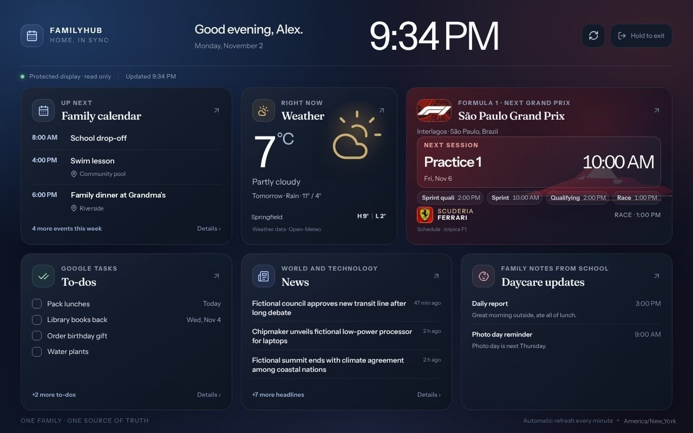
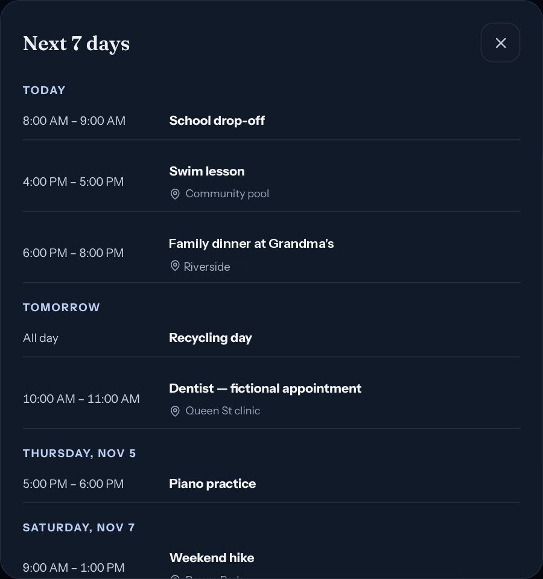
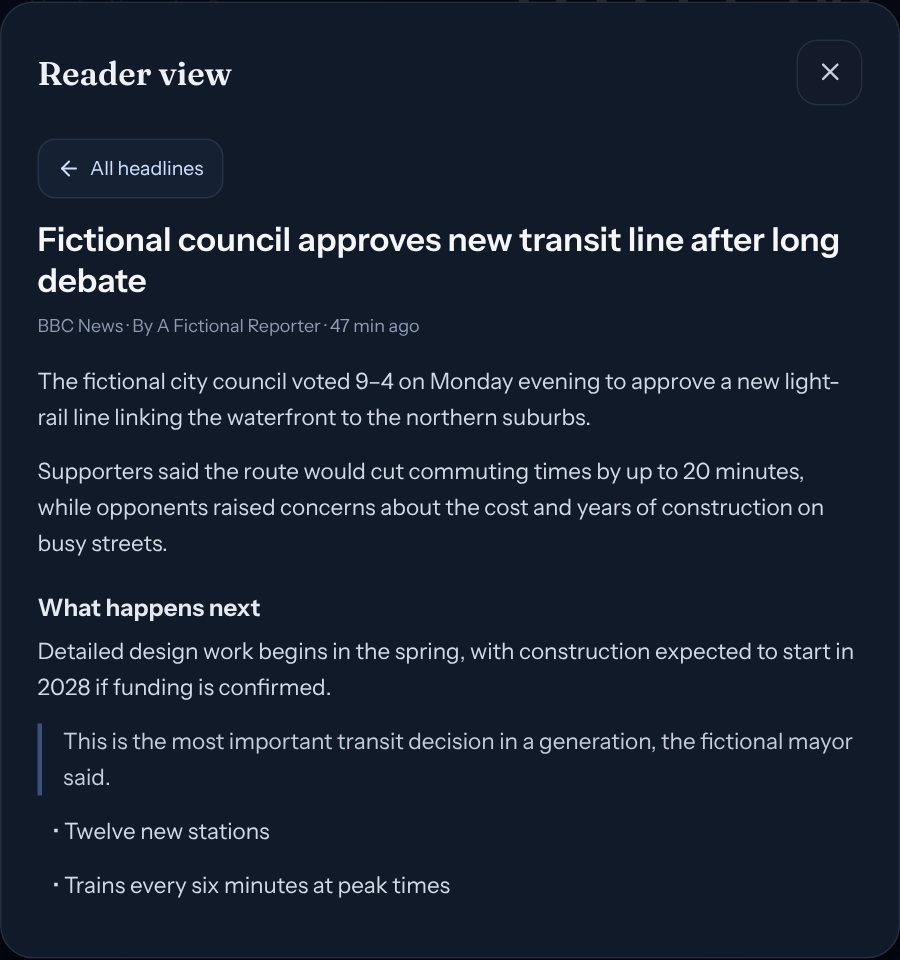
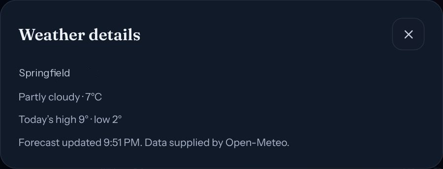
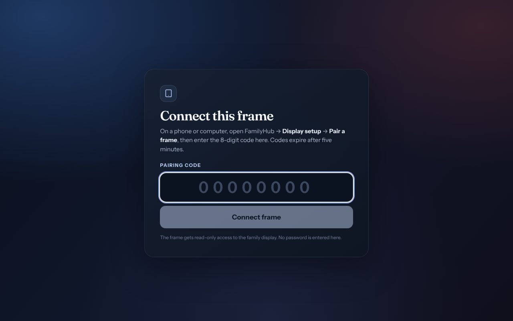
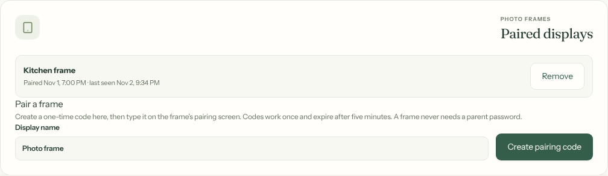

# The photo frame

[Knowledge base index](README.md) · [Using FamilyHub](02-using-family-hub.md) · [Pi deployment](07-raspberry-pi.md) · [Troubleshooting](11-troubleshooting.md)

The kitchen display is a Frameo Wi-Fi photo frame running the read-only
FamilyHub display. This page explains what it shows, how it
was set up and how to keep it running. Command-level details are in the
[frame runbook](../docs/familyhub/FRAME.md).



## What the family sees

* **Cards:** Family calendar (Up next), Weather with tomorrow's forecast, the
  next Formula 1 weekend, To-dos, Chores or News, and Daycare updates. Parents
  choose the cards and weather city in **More → Display setup**.
* **Detail panels:** tap any card. Calendar shows the next 7 days by day; News
  lists ten headlines and opens a reader view; Daycare shows each note in full.
  **All headlines** goes back; tapping outside closes the panel.
* **More indicators:** "+2 more events today", "+7 more headlines" and so on.
* **Quick bar (v1.2):** pills above the footer for guest Wi-Fi (with a QR code), a countdown with a checklist, markets and a photo slideshow. A pill appears once that feature is set up in **Settings → Display**; the frame stays read-only, so nothing can be ticked on it.
* **Richer panels (v1.2):** weather adds feels-like, wind, humidity, air quality, sunrise and sunset, the moon phase and a 7- or 14-day forecast; Formula 1 adds driver and constructor standings next to the schedule. The status line now sits in the footer. Everything is fetched and calculated on the Pi.
* **Not yet checked on the real frame:** v1.2 has not been tested on the physical device. Photos need the LAN listener's photo route, so re-run `apply-lan-display.sh` after installing v1.2.
* **Night mode:** the screen dims on the schedule set in Display setup; a tap
  wakes it for two minutes.
* **Hold to exit:** the only control that leaves the display. Holding it for two
  seconds returns the frame to its pairing screen.
* **Version:** the footer reads "ONE FAMILY · ONE SOURCE OF TRUTH · Family Hub
  vX.Y.Z", the release the Pi is running (since v0.3.7).

| Calendar panel | Reader view | Weather panel |
| --- | --- | --- |
|  |  |  |

## The hardware

| | Our unit (label **105K**) |
| --- | --- |
| Board | Rockchip RK312x, a low-power quad-core chip |
| Android | 6.0.1 (API 23); `userdebug` fingerprint but `adb root` refused |
| Browser engine | Android System WebView 107 (the client also builds for Chromium 104, for margin) |
| Screen | 1280 × 800 landscape, always on |
| Network | 2.4 GHz Wi-Fi on the guest network, address reserved in the router |
| Home app | HomeHQ kiosk (`com.wesbos.homehq`), set as **Always** |
| Disabled | Android System UI (status/navigation bars and the brightness slider), firmware updater `com.adups.fota` (hidden), Frameo (`net.frameo.frame`, can be re-enabled) |

## How the frame reaches FamilyHub

```
frame ──Wi-Fi──▶ https://frame.example.com/display
                 public DNS A record (Cloudflare, DNS only) → the Pi's LAN address
Pi: Caddy bound to the LAN address, Let's Encrypt certificate
    display pages, static assets, display API calls → app on 127.0.0.1:8080
    any other page → 302 /display; any other API path → 404
    nftables: HTTPS only from the frame's address
```

The name is public but points at a private address, so it only works inside the
house. Management (sign-in, Display setup) is only on the Tailscale address;
the frame cannot reach it.

## Pairing a frame

A frame never signs in. When it is not paired, its dashboard address shows the
pairing screen.

| On the frame | In Display setup (phone or Mac, on Tailscale) |
| --- | --- |
|  |  |

1. Display setup → **Paired displays** → name it → **Create pairing code**.
2. Type the 8 digits on the frame. Codes work once and expire in five minutes.
3. The frame shows the dashboard. Display setup lists it with *last seen*.

**Remove** signs out that frame alone. The frame renews its session whenever the
dashboard loads, so it only needs a new code if it was off for over a week, was
removed, or someone held **Hold to exit**.

## Setting one up from scratch

1. Connect the frame by USB with debugging enabled (it already was on ours) and
   install the Android platform tools: `brew install --cask android-platform-tools`.
2. Install HomeHQ, open it and choose it as the Home app with **Always**.
3. Save the dashboard address. HomeHQ remembers a URL **only** when it is passed
   as the `url` extra; otherwise the next restart shows its "Placeholder ·
   offline" sample page:
   ```sh
   deploy/familyhub/frame/frame.sh url https://frame.example.com/display
   ```
4. Set the frame's Wi-Fi IP settings to **DHCP** and reserve its address in the
   router.
5. On the Pi, run the LAN listener script with the frame's address and the
   hostname ([details](../deploy/familyhub/lan-display/README.md)).
6. Pair it (above), then `adb reboot` and confirm the dashboard returns by itself.

## Everyday commands

From the repository on the Mac, with the frame on USB:

| Command | What it does |
| --- | --- |
| `deploy/familyhub/frame/frame.sh home` | Back to the dashboard |
| `deploy/familyhub/frame/frame.sh reload` | Restart the kiosk |
| `deploy/familyhub/frame/frame.sh brightness 120` | Backlight 0–255 (survives restarts) |
| `deploy/familyhub/frame/frame.sh frameo-settings` | Open Frameo's App info to enable or disable it |
| `deploy/familyhub/frame/frame.sh screenshot` | Save a screenshot (contains family data; never commit it) |

## Lessons learned

* **The "placeholder dashboard" was the kiosk, not FamilyHub.** HomeHQ had never
  saved a URL. See step 3 above.
* **Android 6 ignored our DNS.** The router's IPv6 DNS servers took priority over
  the frame's custom DNS, and runtime overrides reset. A public name pointing at
  a private address avoided the whole problem.
* **Signing in on the frame was a dead end.** The LAN listener blocks the login
  API, so a signed-out frame could never get back. Pairing codes replaced it.
* **Slow GPU.** A full-screen blur behind panels made them lag; a solid backdrop
  fixed it.
* **No root.** `adb root` is refused, so app state changes that need system
  rights go through the frame's App info screens.
