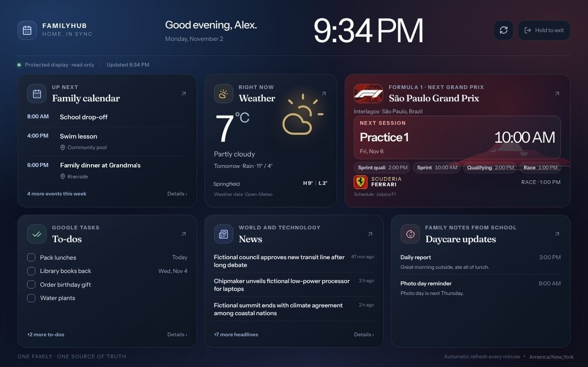

# Family Hub knowledge base

This is the practical guide to Family Hub: what it does, how it was built, how to use and operate it, and how to recover it. Each article is a separate Markdown file that can be read and navigated on GitHub. Paths and addresses in examples are placeholders unless explicitly described as local project paths.

**Current checkpoint: November 8, 2026 (familyhub-v1.6.0 released and running on the Pi, owner-confirmed).** Family Hub runs on a Raspberry Pi 4 behind Tailscale HTTPS and updates itself from versioned releases; the running version is printed in the footer of the display and management pages. v1.6.0 adds a nightly encrypted off-site backup to Cloudflare R2 (set up and restore-tested on the Pi on November 8), budget groups and settlements in the data export, and shopping on several Google Tasks lists; see [backup and recovery](10-backup-recovery.md). v1.6.1 (in review) adds **Back up now** in Settings → Advanced. Recent releases: v1.5 (budget sharing and Splitwise import, calendar editing, frame layout, restart from Settings), v1.5.5 (frame screensaver and night "off"), v1.4 (Board Book look, see [Classic and Board Book looks](18-management-look.md)); the full list is in [releases](09-releases-updates.md). Since v1.0 it is its own product (unused OpenFamily modules and languages other than English and French removed, server-enforced module switches); since v1.4.2 sign-in is email and password only, while the Google connection still feeds Calendar, Tasks, shopping lists and daycare email. v1.1.0 fixed all 33 findings of the November 4 security scan of `server/` and `deploy/`. Confirmed on the household Pi: restart from Settings, ntfy alerts and the off-site backup with a restore drill (November 8). **Not yet verified:** v1.5–v1.6 on the physical frame, live Google Tasks shopping lists, representative live daycare email processing, a deliberate rollback drill on the Pi, recovery onto replacement hardware, and working Gemini inference. The security scan did not cover `client/`, `scripts/`, `shared/` or anything added after November 4. Known gaps are listed in [`docs/familyhub/STATE.md`](../docs/familyhub/STATE.md#known-gaps).

## Start here

| Article | What it covers |
| --- | --- |
| [Project overview](01-overview.md) | Goals, ownership, current status, phases and remaining work |
| [Using Family Hub](02-using-family-hub.md) | Dashboard, calendar, tasks, notes, appearance, budget and modules |
| [Accounts and access](03-accounts-and-access.md) | Sign-in, your name, parent and display access, password changes and account recovery |
| [The photo frame](16-photo-frame.md) | The photo frame, what it shows, pairing, setup from scratch and lessons learned |
| [Classic and Board Book looks](18-management-look.md) | The trial switch between the original look and the Board Book redesign of Home, navigation and Settings |

## Integrations

| Article | What it covers |
| --- | --- |
| [Google Calendar and Tasks](04-google-calendar-tasks.md) | Dedicated Google account, OAuth, source selection and live verification |
| [Daycare updates from Gmail](05-daycare-gmail.md) | Lillio/HiMama messages, optional consent, parsing and privacy |
| [AI assistant](06-ai-assistant.md) | OpenFamily model providers, Ollama, proposal review and Gemini troubleshooting |

## Operations

| Article | What it covers |
| --- | --- |
| [Raspberry Pi deployment](07-raspberry-pi.md) | Installed stack, LAN display listener, firewall, SSH and health checks |
| [Tailscale, HTTPS and DNS](08-tailscale-networking.md) | Connecting devices, MagicDNS, the DNS resolver troubleshooting, private access and the frame's LAN name |
| [Releases and updates](09-releases-updates.md) | GitHub Actions, versioned packages, automatic checks and rollback limits |
| [Backup and recovery](10-backup-recovery.md) | What to preserve, tested restores, safe recovery and incident steps |
| [Renewals and credentials](17-renewals-and-credentials.md) | What expires, what renews itself, replacing a token from Settings → Advanced |
| [Troubleshooting](11-troubleshooting.md) | Common sign-in, networking, photo frame, Google, AI, local-port and service problems |

## Development and governance

| Article | What it covers |
| --- | --- |
| [Development and architecture](12-development-architecture.md) | Code layout, data flow, migrations, environments, builds and tests |
| [Security and privacy](13-security-privacy.md) | Secrets, access boundaries, provider data, backups and safe disclosure |
| [Project history and verification](14-history-and-verification.md) | Milestones, evidence, known gaps and links to historical records |
| [Glossary and reference](15-glossary-reference.md) | Terms, file locations, commands, and primary project references |

Ideas for future builds are collected in [WISHLIST.md](../WISHLIST.md). The older files under [`docs/familyhub/`](../docs/familyhub/) document individual development increments. Some passages there describe the state *at the time they were written*, including the pre-deployment prototype. Prefer this index and the dated checkpoint above for orientation; consult source code and current runtime status before operational changes. Never put secrets or household data in documentation, issues, screenshots or Git history.
